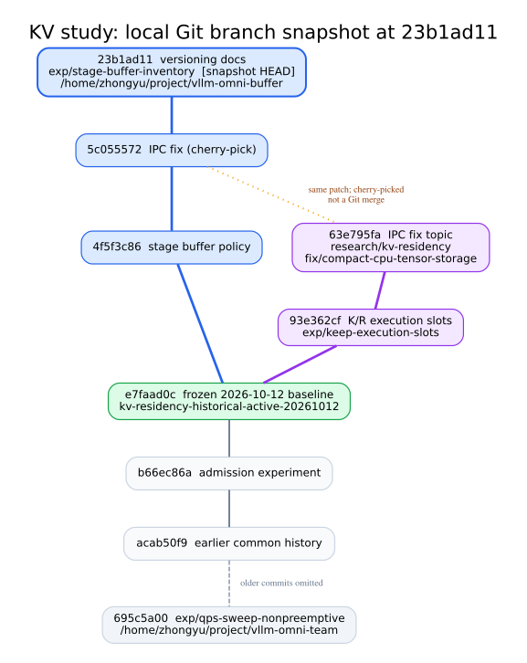

# 研究分支图（23b1ad11 快照）

本图从 Git 父提交、merge-base 和 cherry-pick 来源生成。实线为直接父提交；灰色虚线省略了更早的中间提交；橙色点线是 cherry-pick，**不是 merge**。图固定在 `23b1ad11` 提交时的状态，以后新增提交不会自动反映在这张快照中。

- `exp/stage-buffer-inventory` 是固定工作树的维护分支，快照 HEAD 为 `23b1ad11`。
- `exp/keep-execution-slots` 从 `e7faad0c` 分叉，快照时尚未合入维护分支。
- `research/kv-residency` 和 `fix/compact-cpu-tensor-storage` 同指向 `63e795fa`，是整理过程的本地中间分支。
- `5c055572` 从 `63e795fa` cherry-pick 而来，IPC 修复代码已经进入维护分支，但两条分支的历史没有 merge。
- `exp/qps-sweep-nonpreemptive` 是更早的祖先分支，图省略了部分历史。

本目录存放静态快照及可编辑的 `branch_graph.dot`。最新关系请在 `/home/zhongyu/project/vllm-omni-buffer` 执行 `git log --graph --oneline --decorate --all`。
